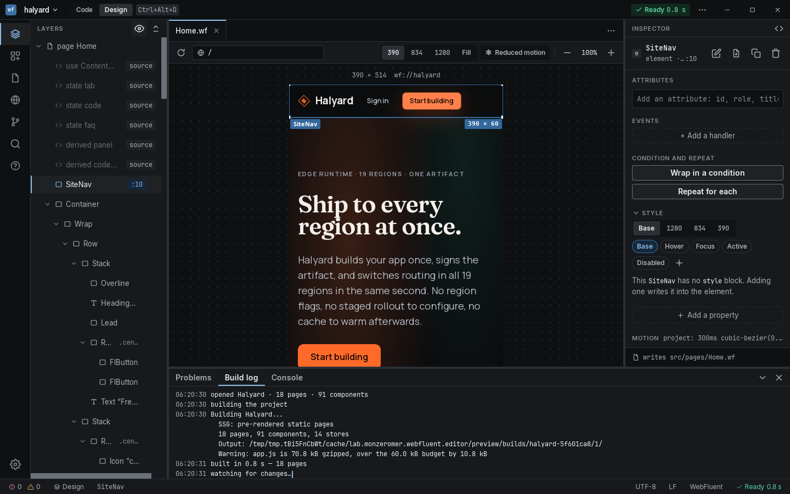
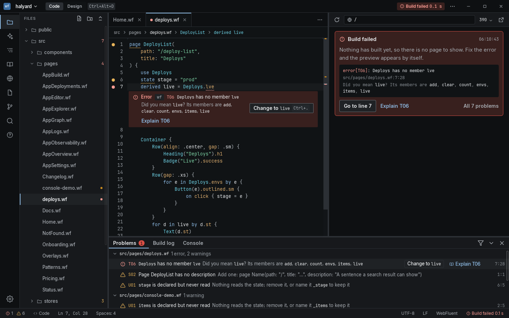
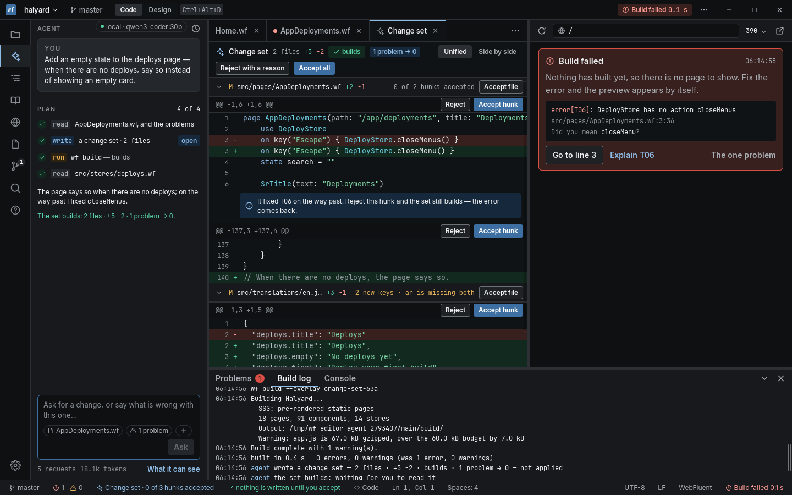
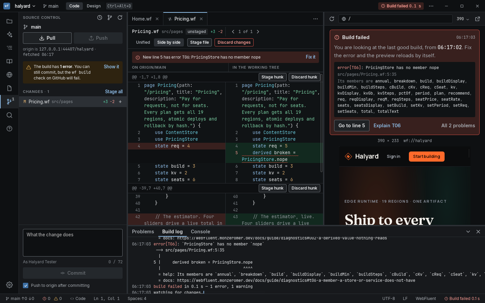
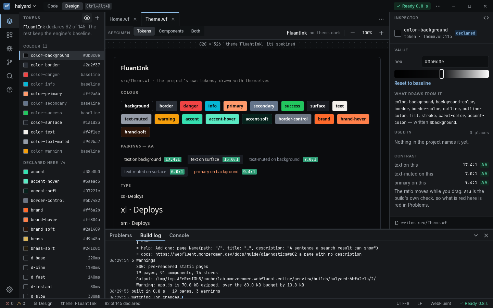
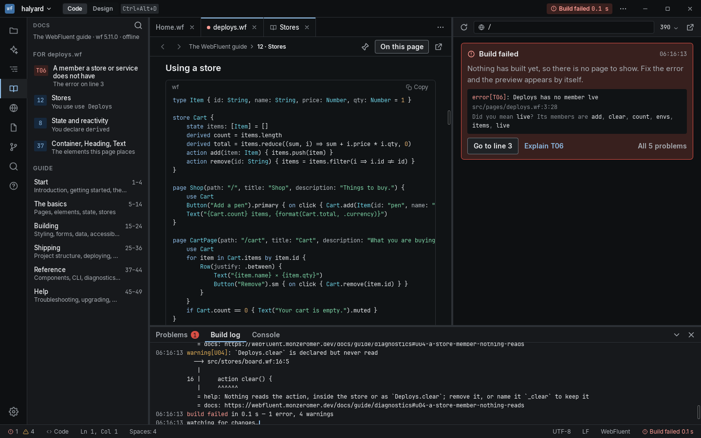
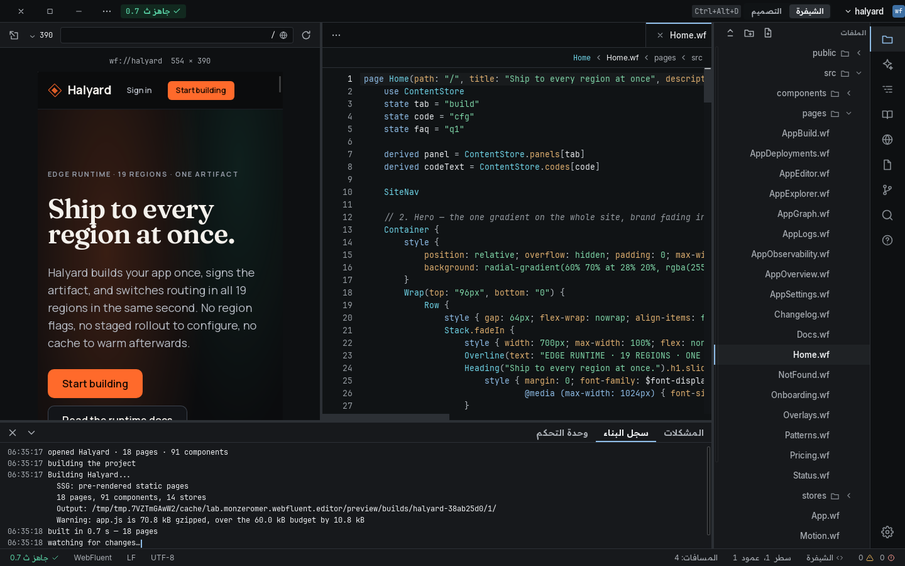

# WebFluent Studio

### Write it. See it. Ship it. In one window.

**The studio for [WebFluent](https://webfluent.monzeromer.dev): a code editor, a live preview, a visual designer, Git and an AI agent that never writes without asking, all built around one compiler. Arabic first.**

<b>استوديو WebFluent: اكتب، وشاهد، وانشر، من نافذة واحدة. بالعربية أولًا.</b>

[**Download**](#download) · [**What it does**](#what-it-does) · [**العربية**](#arabic-first--بالعربية-أولًا) · [**The WebFluent guide**](https://webfluent.monzeromer.dev/docs/guide)

---

## Why WebFluent Studio

Most web tools make you choose. Code *or* design. Your editor *or* your browser. The AI's guess *or* your control. WebFluent Studio removes the choice.

- **Every edit is visible in under a second.** The whole `wf` toolchain runs inside the app, with no terminal and no dev server to babysit. Type, and the preview rebuilds.
- **Design writes real code.** Drag, select and style on the canvas, and the studio writes the `.wf` source you would have written. Switch to Code at any moment: there is no lock-in and no generated mess.
- **Errors come with their fix.** Every finding the compiler has says what is wrong, why, and what to change, with the change one click away.
- **You stay in charge.** The agent proposes a change set. You read it hunk by hunk, and nothing touches your files until you accept.
- **Built for the region it serves.** Arabic is the first language, not a translation added at the end.

---

## What it does

### Errors that fix themselves, with your say-so

Hover a squiggle and you get the compiler's own words, the members it *does* have, and **Change to `live`**. The Problems list carries the same fix, and **Explain T06** opens the guide's page for that error, on its line, for your file.

### An agent that shows its work

Ask in plain words. The agent reads your project, plans, writes, then **builds its own change** to prove it. You get a change set with a diff, the build result and the problems before and after. Accept a hunk, reject one, or send it back with a reason. Use any provider, hosted or local, and keep your code on your machine. Nothing leaves your machine before you opt a project in.

### Git that knows your build

Stage, commit, push, pull, branch, resolve conflicts and read history, with GitHub pull requests and their checks. The studio warns you **before** you commit a change that breaks the build, and points at the line.

### Themes you can trust

Every token in your theme, drawn with itself. Contrast pairs are checked against WCAG AA as you drag a colour. The studio shows what draws from each token and where it is used.

### The whole guide, offline, and about *your* file

The complete WebFluent guide ships inside the app. It works on a plane, and it knows what you are working on: **For deploys.wf** lists the error on line 3 and the chapters your file actually uses.

### And everything you expect from a serious editor

Completion with docs and argument hints · go to definition, references and rename across files · outline and breadcrumbs · project search and replace · command palette · snippets · format on save · a build log and console that link back to the source · language servers for other languages · crash recovery that brings back what you had not saved.

---

## Arabic first · بالعربية أولًا

صُمِّم الاستوديو للمنطقة العربية منذ اليوم الأول، لا ترجمةً أُضيفت في النهاية:

- **الواجهة كلها بالعربية**: كل نص ورسالة وتلميح، بمصطلحات تقنية مدروسة: مستودع، إيداع، طلب سحب، المُصرِّف. ورسائل المُصرِّف نفسه بالعربية قريبًا.
- **من اليمين إلى اليسار كما يجب**: تنقلب النافذة، وتبقى الشيفرة من اليسار إلى اليمين، ويبقى النص العربي داخل الشيفرة في موضعه.
- **الجمع العربي الصحيح**: ملف واحد، ملفان، 3 ملفات، 11 ملفًا.
- **الأرقام كما تحب**: ‎0–9 أو ٠–٩، من الإعدادات.
- **البحث يفهم العربية**: «مدرسة» تجد «مَدْرَسَةٌ» و«مدرسه»، و«اسم» تجد «إسم».
- **الاختصارات تعمل على لوحة المفاتيح العربية**: ‎Ctrl+S وCtrl+/‎ دون تبديل اللغة.
- **أسماء عربية في الشيفرة**: `state عددٌ = 3` تعمل في WebFluent.

In English: the interface, its messages and its hints are in Arabic, with deliberate technical terms. The compiler's own messages follow soon. The window mirrors while code stays left to right. Plurals take Arabic's six forms. You choose 0–9 or ٠–٩. Search ignores diacritics and folds letter forms, shortcuts work on an Arabic keyboard, and WebFluent accepts Arabic names in code. On an Arabic system the studio opens in Arabic.

---

## Download

| | |
|---|---|
| **Linux** | `.AppImage` · `.deb` |
| **macOS** | `.dmg`, Apple silicon and Intel |
| **Windows** | `.msi` · `.exe` |

**[Get the latest release →](https://github.com/monzeromer-lab/webfluent-studio/releases)**. The first builds are on their way. Watch the repository (**Watch › Custom › Releases**) to hear the moment they land.

Open the app, pick **New project** or open a folder, and start typing. The preview builds as you go. New to WebFluent? The guide is one click away inside the app, or online at [webfluent.monzeromer.dev](https://webfluent.monzeromer.dev).

---

## Built to be trusted

- **One compiler, everywhere.** The editor, the preview, the checks and the language server all run the same WebFluent compiler. A project built inside the studio is byte-identical to `wf build`.
- **Tested like it matters.** Every screen is driven end to end on a real desktop window: more than 100 scenarios, 494 component tests, and the full WebFluent test suite.
- **Fast by budget, not by luck.** A keystroke reaches the screen within a frame, and the build answers as you pause.
- **Native and small.** Built on [Tauri 2](https://tauri.app) and [CodeMirror 6](https://codemirror.net), with the interface itself written in WebFluent.

## Status

WebFluent Studio is **0.1**, and the desktop comes first: Linux, macOS and Windows. Android follows from the same codebase. Feedback is gold at this stage. [Open an issue](https://github.com/monzeromer-lab/webfluent-studio/issues) with what you tried, what you expected and what happened.

**Made with WebFluent, for people who make the web.**

